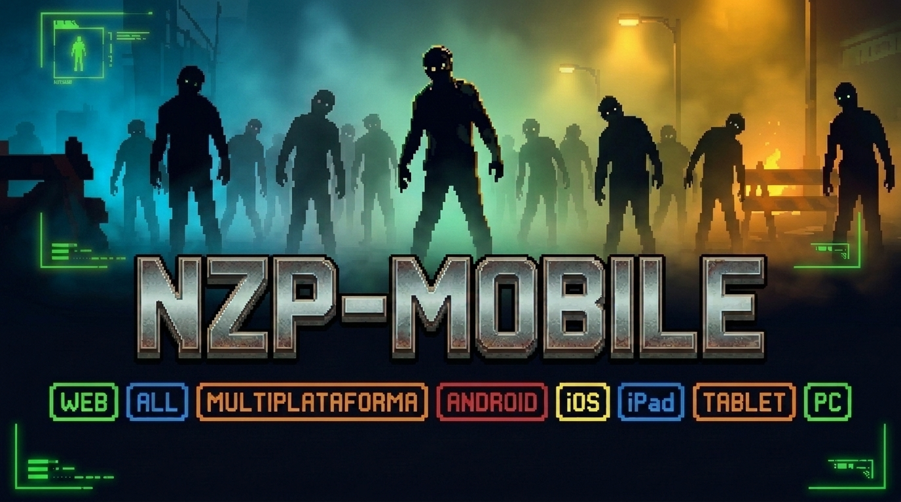

  

---

## 📖 Índice de Contenidos

1. [¿Qué es NZP-Mobile?](#-qué-es-nzp-mobile)
2. [Características Principales](#-características-principales)
3. [Tutorial Paso a Paso: Cómo Activar la Cámara y Jugar](#-tutorial-paso-a-paso-cómo-activar-la-cámara-y-jugar)
4. [Guía Completa de Controles en Pantalla](#-guía-completa-de-controles-en-pantalla)
5. [Mecánicas de Juego y Sistema de Supervivencia](#-mecánicas-de-juego-y-sistema-de-supervivencia)
6. [Mapas y Escenarios](#-mapas-y-escenarios)
7. [Armamento, Caja Misteriosa y Mejoras](#-armamento-caja-misteriosa-y-mejoras)
8. [Máquinas de Ventajas (Perks)](#-máquinas-de-ventajas-perks)
9. [Estrategias Avanzadas para Rondas Altas](#-estrategias-avanzadas-para-rondas-altas)
10. [Despliegue Local y Desarrollo](#-despliegue-local-y-desarrollo)
11. [Preguntas Frecuentes (FAQ)](#-preguntas-frecuentes-faq)
12. [Créditos y Agradecimientos](#-créditos-y-agradecimientos)

---

## 🎮 ¿Qué es NZP-Mobile?

**NZP-Mobile** es un *fork* / adaptación enfocada en dispositivos móviles del clásico modo de supervivencia por oleadas ejecutado mediante tecnología **WebGL y WebAssembly (WASM)**. El objetivo principal de este proyecto es eliminar la barrera del teclado y el ratón físicos, permitiendo que cualquier persona pueda abrir su navegador web y disfrutar de una partida fluida directamente desde la pantalla táctil de su teléfono o tablet.

A diferencia de otras versiones web diseñadas exclusivamente para computadoras de escritorio, **NZP-Mobile** integra una capa personalizada en JavaScript y CSS (`touch.js`) que dibuja sobre el lienzo del juego un sistema completo de **doble joystick analógico virtual** y **botones de acción ergonómicos**, traduciendo cada toque en señales nativas que el motor gráfico entiende en tiempo real sin pérdida de rendimiento.

---

## ✨ Características Principales

* **100% Basado en Web:** No requiere descargar archivos APK, ni hacer *jailbreak*, ni instalar emuladores pesados. Todo corre dentro de una pestaña del navegador.
* **Doble Joystick Virtual (`touch.js`):** Control independiente para desplazamiento omnidireccional en la mano izquierda y rotación fluida de cámara en 360 grados en la mano derecha.
* **Botones de Acción Dedicados:** Acceso rápido e intuitivo para disparar, apuntar con precisión, saltar, recargar e interactuar con el entorno.
* **Arquitectura Ultra Ligera:** Todo el paquete del juego ocupa menos de 100 MB, lo que permite tiempos de carga muy rápidos incluso con datos móviles o conexiones modestas.
* **Soporte Híbrido (Táctil + Periféricos):** Si juegas en una laptop con pantalla táctil, en un iPad con teclado o en una PC convencional, puedes alternar libremente entre los controles en pantalla y tu teclado/ratón.
* **Fidelidad de Jugabilidad Clásica:** Conserva el sistema clásico de rondas infinitas, economía por puntos, reparación de barricadas, compra de armas en paredes, cajas aleatorias y máquinas de bebidas potenciadoras.

---

## 🕹️ Tutorial Paso a Paso: Cómo Activar la Cámara y Jugar

Los navegadores móviles modernos (como Chrome en Android o Safari en iOS) cuentan con protecciones de seguridad que bloquean el movimiento continuo de cámara hasta que el usuario interactúa activamente con la página y activa el modo inmersivo.

Sigue exactamente estos pasos al entrar al juego para que el joystick derecho funcione a la perfección:

1. **Abre el enlace del juego:** Espera unos segundos a que terminen de cargarse los recursos WebAssembly en la barra de progreso.
2. **Inicia el motor:** Toca el botón o texto que dice **"Click To Begin!"** en el centro de la pantalla.
3. **Configura tu partida:** Navega por el menú principal y selecciona **Solo** para iniciar una partida individual en el mapa que prefieras.
4. **Activa el modo pantalla completa (Paso Clave):** Una vez que aparezcas dentro del mapa, **juega un par de segundos presionando los botones en pantalla** (toca **FIRE**, **JUMP** o toca directamente sobre el centro de la pantalla del juego). Esta interacción le indica al navegador que debe activar el bloqueo de puntero (*Pointer Lock*) y la pantalla completa.
5. **Usa el Joystick Derecho o el Táctil:** En cuanto el navegador entre en modo inmersivo, el **Joystick Derecho** responderá de inmediato para mover la cámara hacia arriba, abajo, izquierda y derecha. Adicionalmente, también puedes deslizar el dedo sobre la pantalla para ajustar la mira de forma táctil.

> **Consejo:** Se recomienda jugar con el teléfono en **posición horizontal (paisaje)** para tener una visión panorámica del mapa y mayor comodidad en ambos pulgares.

---

## 🎛️ Guía Completa de Controles en Pantalla

La interfaz táctil está distribuida estratégicamente para evitar que tus dedos tapen el centro de la mira:

| Control en Pantalla | Ubicación | Función en el Juego | Equivalente PC |
| :--- | :--- | :--- | :--- |
| **Joystick Izquierdo** | Esquina inferior izquierda | Mueve al personaje hacia adelante, atrás y los lados | Teclas `W`, `A`, `S`, `D` |
| **Joystick Derecho** | Esquina inferior derecha | Gira la cámara en 360° y permite apuntar a los enemigos | Movimiento del Ratón |
| **FIRE (Rojo)** | Derecha (botón grande) | Dispara el arma equipada o realiza ataque cuerpo a cuerpo | Clic Izquierdo |
| **ADS** | Encima de FIRE | Activa la mira de hierro / precisión del arma | Clic Derecho |
| **JUMP** | Zona media-derecha | Permite saltar obstáculos, barandillas y escalones | Barra Espaciadora |
| **USE (E) (Verde)** | Esquina media-derecha | Comprar armas de pared, abrir puertas, activar electricidad, usar la caja y reparar ventanas | Tecla `E` / `F` |
| **R** | Izquierda de FIRE | Recarga el cargador del arma actual | Tecla `R` |

---

## ⚙️ Mecánicas de Juego y Sistema de Supervivencia

El núcleo del juego se basa en resistir oleadas interminables de enemigos cuya velocidad, resistencia y agresividad aumentan progresivamente con cada ronda:

* **Sistema de Puntos (Economía):** Cada acción ofensiva o defensiva otorga puntos. Impactar disparos suma pequeños montos por bala, eliminar enemigos otorga una bonificación mayor (especialmente mediante disparos a la cabeza o ataques cuerpo a cuerpo) y reconstruir ventanas rotas genera ingresos constantes al inicio de cada ronda.
* **Progresión de Rondas:** Las primeras oleadas son lentas y permiten acumular capital. A partir de rondas intermedias, los enemigos comienzan a correr y aparecen en mayor número desde múltiples puntos de entrada simultáneos.
* **Gestión de Salud:** El personaje cuenta con regeneración automática de salud tras evitar recibir daño durante unos segundos. Si recibes varios golpes seguidos sin cobertura, la pantalla se teñirá de rojo indicando peligro crítico.
* **Potenciadores Temporales (Drops):** Al eliminar enemigos, ocasionalmente soltarán objetos brillantes en el suelo con efectos inmediatos:
  * **Munición Máxima:** Rellena al 100% las reservas de balas y granadas de todas tus armas.
  * **Muerte Instantánea:** Permite eliminar a cualquier enemigo de un solo disparo o golpe durante 30 segundos.
  * **Puntos Dobles:** Duplica todos los puntos obtenidos por disparos, bajas y reparaciones durante 30 segundos.
  * **Bomba Nuclear:** Elimina al instante a todos los enemigos activos en el mapa y otorga una bonificación de puntos a todos los jugadores.

---

## 🗺️ Mapas y Escenarios

Dependiendo de la rotación incluida en los archivos del servidor, podrás poner a prueba tu resistencia en distintos entornos tácticos:

* **Nacht der Untoten:** Un edificio abandonado de tres salas conectadas. Es un mapa compacto y claustrofóbico donde no hay máquinas de ventajas, obligando al jugador a depender puramente de su puntería, gestión de munición y control de ventanas.
* **Kino der Toten:** Un amplio teatro con escenario principal, telón, teletransportador y múltiples salas conectadas para hacer trenes de enemigos. Ideal para aplicar estrategias de movimiento circular y aprovechar trampas eléctricas.
* **Escenarios Adicionales:** La estructura modular de la carpeta `nzp/` soporta mapas clásicos adicionales y creaciones de la comunidad con mecánicas únicas, interruptores de energía y zonas secretas.

---

## 🔫 Armamento, Caja Misteriosa y Mejoras

Para sobrevivir más allá de las rondas iniciales necesitarás actualizar constantemente tu arsenal:

* **Armas de Pared (Wallbuys):** Están dibujadas con tiza blanca en las paredes de distintas salas. Tienen un costo fijo y te permiten **comprar munición en cualquier momento** acercándote a la silueta y manteniendo presionado **USE (E)**.
* **Caja Misteriosa (Mystery Box):** Un cofre de madera iluminado que aparece en ubicaciones específicas del mapa. Por un costo fijo de puntos, entrega un arma completamente aleatoria que puede ir desde rifles de asalto y ametralladoras ligeras hasta armas especiales de ciencia ficción.
* **Máquina Potenciadora (Pack-a-Punch):** En los mapas que cuentan con electricidad y teletransportador, permite mejorar tus armas a cambio de una suma elevada de puntos, aumentando drásticamente su daño, capacidad de cargador, cadencia y cambiando el aspecto y sonido de los disparos.

---

## 🧪 Máquinas de Ventajas (Perks)

Una vez que localices y actives el interruptor de electricidad en el mapa, podrás adquirir mejoras permanentes (mientras no seas derribado) en las máquinas expendedoras repartidas por las salas:

* **Juggernog (Rojo):** Aumenta considerablemente tu resistencia física, permitiéndote soportar muchos más golpes antes de caer. Es la prioridad número uno en cualquier partida.
* **Speed Cola (Verde):** Reduce a la mitad el tiempo necesario para recargar cualquier arma, vital cuando usas ametralladoras pesadas o escopetas.
* **Double Tap (Amarillo/Naranja):** Incrementa la cadencia de disparo de todas tus armas, aumentando el daño por segundo frente a grupos grandes.
